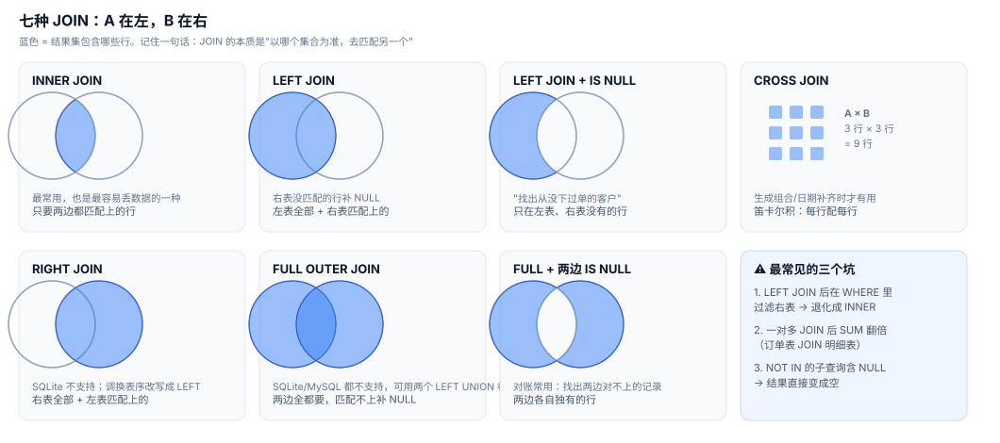

# 04 · JOIN 全解：集合思维与三大陷阱

> 一句话：JOIN 的本质是"以哪个集合为准，去匹配另一个"。三种陷阱（退化、膨胀、NOT IN 失效）全部能在 atlas.db 上实测复现。



## 4.1 INNER JOIN：有条件的匹配

```sql
SELECT c.name, o.order_no, o.ordered_at
FROM customers c
JOIN orders o ON o.customer_id = c.customer_id
WHERE o.status = 'paid'
ORDER BY o.ordered_at DESC LIMIT 3;
```

**行数守恒检查**（写 JOIN 的第一个职业习惯）：

```sql
SELECT
  (SELECT COUNT(*) FROM customers)                                   AS 客户总数,
  (SELECT COUNT(DISTINCT customer_id) FROM orders)                   AS 有订单客户,
  (SELECT COUNT(DISTINCT c.customer_id) FROM customers c
     JOIN orders o ON o.customer_id = c.customer_id)                 AS INNER_JOIN后;
```

```
300        252        252
```

INNER JOIN 后只剩 252 个客户 —— **48 个没下过单的客户被无声丢掉了**。如果你的业务恰恰是"找出没下单的人做召回"，INNER JOIN 从一开始就把答案扔了。

## 4.2 LEFT JOIN：保住左表的全部

```sql
SELECT c.name, c.city, COUNT(o.order_id) AS 订单数
FROM customers c
LEFT JOIN orders o ON o.customer_id = c.customer_id
GROUP BY c.customer_id
HAVING COUNT(o.order_id) = 0
ORDER BY c.name LIMIT 5;
```

```
┌────────┬──────┬────────┐
│ name   │ city │ 订单数 │
├────────┼──────┼────────┤
│ 何艳   │ 广州 │      0 │
│ 刘思远 │ 深圳 │      0 │
│ ...    │      │        │
└────────┴──────┴────────┘
```

注意 `COUNT(o.order_id)` 而不是 `COUNT(*)` —— 没匹配上的行，`o.*` 全是 NULL，`COUNT(*)` 会把这种"空壳行"也数成 1。

## 4.3 陷阱一：WHERE 让 LEFT JOIN 退化成 INNER

这是 Stack Overflow 上被问了几千遍的问题。看实测：

```sql
SELECT
  (SELECT COUNT(*) FROM customers c
     LEFT JOIN orders o ON o.customer_id = c.customer_id)              AS LEFT_JOIN行数,
  (SELECT COUNT(*) FROM customers c
     LEFT JOIN orders o ON o.customer_id = c.customer_id
     WHERE o.status = 'paid')                                          AS 加WHERE后;
```

```
3048          1088
```

**3048 → 1088，LEFT JOIN 白写了。** 原因：LEFT JOIN 为无订单客户保留了一行"全 NULL 的右表"，而 `WHERE o.status = 'paid'` 对 NULL 判定为"未知"，把这行过滤掉了 —— 退化成 INNER JOIN。

**正确写法：过滤右表的条件放进 ON**

```sql
SELECT c.name, COUNT(o.order_id) AS 已支付订单数
FROM customers c
LEFT JOIN orders o
       ON o.customer_id = c.customer_id      -- 匹配条件
      AND o.status = 'paid'                  -- ← 过滤写这里！
GROUP BY c.customer_id
HAVING COUNT(o.order_id) = 0;                -- 现在能查出"没有已支付订单的人"了
```

记忆：**ON 决定"怎么匹配"，WHERE 决定"留下谁"。对右表的过滤想保留 NULL 行，就必须写在 ON 里。**

## 4.4 陷阱二：一对多 JOIN 的行数膨胀

订单 : 明细 = 1 : 1~5。JOIN 之后：

```sql
SELECT
  (SELECT COUNT(*) FROM orders)                                          AS 订单数,
  (SELECT COUNT(*) FROM orders o JOIN order_items i
      ON i.order_id = o.order_id)                                        AS JOIN明细后,
  ROUND((SELECT COUNT(*) FROM orders o JOIN order_items i
      ON i.order_id = o.order_id) * 1.0
      / (SELECT COUNT(*) FROM orders), 2)                                AS 膨胀倍数;
```

```
3000       6048       2.02
```

**行数直接翻倍。** 如果这时候你在 JOIN 结果里对**订单级**的金额求和，灾难来了：

```sql
SELECT
  (SELECT ROUND(SUM(amount), 2) FROM payments WHERE is_refund = 0)     AS 正确支付总额,
  (SELECT ROUND(SUM(p.amount), 2)
     FROM orders o
     JOIN order_items i ON i.order_id = o.order_id
     JOIN payments p ON p.order_id = o.order_id AND p.is_refund = 0)   AS 三表JOIN后,
  ROUND((SELECT SUM(p.amount) FROM orders o
         JOIN order_items i ON i.order_id = o.order_id
         JOIN payments p ON p.order_id = o.order_id AND p.is_refund = 0)
        / (SELECT SUM(amount) FROM payments WHERE is_refund = 0), 2)   AS 放大倍数;
```

```
15281991.51    40395593.16    2.64
```

**凭空多出 2500 万的假销售额，放大 2.64 倍。** 每笔支付跟着它的 2~5 条明细被重复计了一次。

修法是"先聚合再 JOIN"：

```sql
-- 先把明细聚合到订单粒度，再和支付表 JOIN —— 粒度对齐后求和才安全
WITH order_amt AS (
  SELECT order_id, SUM(quantity * unit_price * (1 - discount)) AS amt
  FROM order_items GROUP BY order_id
)
SELECT ROUND(SUM(p.amount), 2) AS 支付总额
FROM payments p
JOIN (SELECT order_id, SUM(amt) AS amt FROM order_amt GROUP BY order_id) o
  ON o.order_id = p.order_id
WHERE p.is_refund = 0 AND o.amt > 0;
```

**守则：SUM 之前先问自己"我现在一行代表什么粒度？"**

## 4.5 自连接：同一张表和自己 JOIN

atlas.db 的 `employees.manager_id` 指向自己。查"同一城市的金卡客户对"：

```sql
SELECT a.name AS 客户A, b.name AS 客户B, a.city
FROM customers a
JOIN customers b ON a.city = b.city AND a.customer_id < b.customer_id   -- < 防止 (A,B)/(B,A) 重复和自己配自己
WHERE a.tier = 'gold' AND b.tier = 'gold'
ORDER BY a.city LIMIT 5;
```

```
┌────────┬───────┬──────┐
│ 客户A  │ 客户B │ city │
├────────┼───────┼──────┤
│ 刘宇轩 │ 黄明  │ 北京 │
│ 郭娜   │ 杨强  │ 南京 │
│ ...    │       │      │
└────────┴───────┴──────┘
```

自连接的要点：**必须用别名区分两个"自己"**；配对类查询用 `a.x < b.x` 消除镜像对。

## 4.6 反连接：三种写法与 NOT IN 的 NULL 灾难

"找出从没下过单的客户"，三种写法结果一致：

```sql
SELECT
  (SELECT COUNT(*) FROM customers c
     WHERE c.customer_id NOT IN (SELECT customer_id FROM orders))            AS NOT_IN,
  (SELECT COUNT(*) FROM customers c
     WHERE NOT EXISTS (SELECT 1 FROM orders o
                        WHERE o.customer_id = c.customer_id))                AS NOT_EXISTS,
  (SELECT COUNT(*) FROM customers c
     LEFT JOIN orders o ON o.customer_id = c.customer_id
     WHERE o.order_id IS NULL)                                               AS LEFT_JOIN;
```

```
48     48     48
```

三者数学等价，但 **`NOT IN` 有一个著名的地雷**：子查询结果里只要有一个 NULL，整个 `NOT IN` 永远为假。实测：

```sql
SELECT
  (SELECT COUNT(*) FROM customers c
     WHERE c.customer_id NOT IN
       (SELECT employee_id FROM employees))                          AS 子查询无NULL,
  (SELECT COUNT(*) FROM customers c
     WHERE c.customer_id NOT IN
       (SELECT manager_id FROM employees
        WHERE manager_id IS NOT NULL))                               AS 手动过滤NULL后;
-- 第一列换成 (SELECT manager_id FROM employees)（含 NULL）试试：
```

```
274     287
```

子查询一旦含 NULL，`x NOT IN (1,2,NULL)` 的求值是 `x≠1 AND x≠2 AND x≠NULL` = `真 AND 真 AND 未知` = **未知** → 整行被 WHERE 扔掉。**结论：永远用 `NOT EXISTS` 或 `LEFT JOIN ... IS NULL`，别用 `NOT IN`**（除非你能保证子查询列有 NOT NULL 约束）。

## 4.7 JOIN 语法建议

- 显式 `JOIN ... ON`，永远不写逗号连接 `FROM a, b WHERE ...`（那是隐式 JOIN，漏一个条件就是笛卡尔积）
- 驱动表放左边只是阅读习惯，优化器通常自己决定顺序（基于成本的优化）
- `USING (order_id)` 可以在两边列名相同时少打字，但会改变 `SELECT *` 的列布局，团队里二选一，保持一致

## 自测

1. `LEFT JOIN` 后接 `WHERE 右表.列 = X`，结果集和 `INNER JOIN` 有什么关系？正确写法是什么？
2. 为什么"订单 JOIN 明细后 SUM 订单金额"会翻倍？写出两种修复方案。
3. `NOT IN` 在什么前提下才能安全使用？更稳妥的替代是哪两种？
4. `COUNT(o.order_id)` 和 `COUNT(*)` 在 LEFT JOIN 后为什么结果不同？
