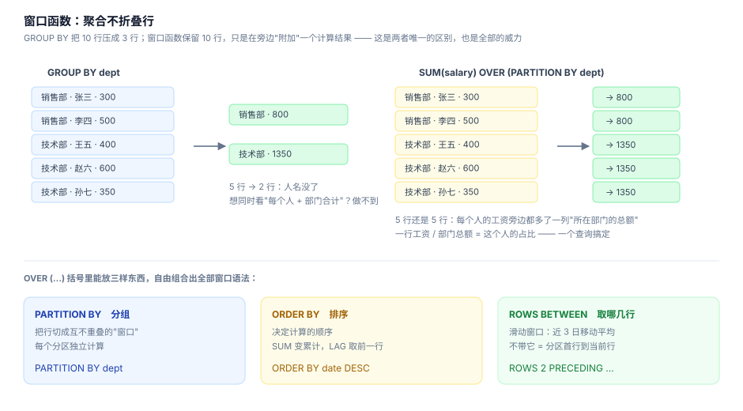

# 06 · 窗口函数：聚合不折叠行

> 一句话：GROUP BY 把 N 行压成 G 行；窗口函数保留 N 行，只是在每行旁边附加一个计算结果。所有"排名、环比、累计、组内 TopN"类需求，都是它的主场。



## 6.1 语法骨架

```sql
函数名(参数) OVER (
    PARTITION BY ...   -- 可选：把行切成互不重叠的分区
    ORDER BY ...       -- 可选：分区内的计算顺序
    ROWS BETWEEN ...   -- 可选：滑动窗口帧
)
```

三个组成部分的直觉：
- `PARTITION BY dept` = "在每个部门内部各自计算"
- `ORDER BY date` = "按日期顺序累积/对比"
- `ROWS BETWEEN 2 PRECEDING AND CURRENT ROW` = "只用最近 3 行算"

## 6.2 三个排名函数：一个实验分清

```sql
WITH v(x) AS (VALUES (100),(100),(90),(80),(80),(80),(70))
SELECT x,
       ROW_NUMBER() OVER (ORDER BY x DESC) AS rn,
       RANK()       OVER (ORDER BY x DESC) AS rnk,
       DENSE_RANK() OVER (ORDER BY x DESC) AS drnk
FROM v;
```

```
┌─────┬────┬─────┬──────┐
│ x   │ rn │ rnk │ drnk │
├─────┼────┼─────┼──────┤
│ 100 │  1 │   1 │    1 │
│ 100 │  2 │   1 │    1 │
│  90 │  3 │   3 │    2 │
│  80 │  4 │   4 │    3 │
│  80 │  5 │   4 │    3 │
│  80 │  6 │   4 │    3 │
│  70 │  7 │   7 │    4 │
└─────┴────┴─────┴──────┘
```

| 函数 | 并列时 | 下一个 | 用途 |
|---|---|---|---|
| `ROW_NUMBER` | 强制分 1/2 | 3 | 取"恰好 N 行"（分页、TopN 去并列） |
| `RANK` | 并列同名次 | 跳号（1,1,**3**） | 比赛排名 |
| `DENSE_RANK` | 并列同名次 | 不跳号（1,1,**2**） | 等级/档位 |

**取 Top-N 用 `ROW_NUMBER` + 外层过滤 `rn <= N`**（并列会让 RANK 多返回行，业务上往往不可接受）。

## 6.3 组内 TopN：窗口函数的招牌菜

"每个城市销售额最高的 2 个客户" —— 用 GROUP BY 写不出来（聚合后城市只剩一行），用窗口函数三步走：

```sql
WITH s AS (
  SELECT c.customer_id, c.name, c.city,
         SUM(i.quantity * i.unit_price * (1 - i.discount)) AS 销售额
  FROM customers c
  JOIN orders o ON o.customer_id = c.customer_id
  JOIN order_items i ON i.order_id = o.order_id
  WHERE o.status IN ('paid', 'shipped')
  GROUP BY c.customer_id
), ranked AS (
  SELECT *, ROW_NUMBER() OVER (PARTITION BY city ORDER BY 销售额 DESC) AS rn
  FROM s
)
SELECT city, name, ROUND(销售额,0) AS 销售额, rn
FROM ranked WHERE rn <= 2 AND city IN ('深圳','上海','北京')
ORDER BY city, rn;
```

```
┌──────┬────────┬──────────┬────┐
│ city │ name   │ 销售额   │ rn │
├──────┼────────┼──────────┼────┤
│ 上海 │ 吴娟   │ 106701.0 │  1 │
│ 上海 │ 何超   │  79842.0 │  2 │
│ 北京 │ 马明   │ 218567.0 │  1 │
│ 北京 │ 林超   │ 183063.0 │  2 │
│ 深圳 │ 黄梓涵 │ 171597.0 │  1 │
│ 深圳 │ 刘嘉怡 │ 111575.0 │  2 │
└──────┴────────┴──────────┴────┘
```

**记住这个三段式：聚合求指标 → 窗口求排名 → 外层取前 N。** 面试和实际工作出现频率都极高。

## 6.4 LAG/LEAD：环比与同比

`LAG(col)` 取"上一行的值"，环比一步到位：

```sql
WITH m AS (
  SELECT strftime('%Y-%m', ordered_at) AS ym,
         ROUND(SUM(i.quantity * i.unit_price * (1 - i.discount)), 0) AS 销售额
  FROM orders o JOIN order_items i ON i.order_id = o.order_id
  WHERE o.status IN ('paid','shipped') AND o.ordered_at >= '2024-06-01'
  GROUP BY ym
)
SELECT ym AS 月份, 销售额,
       LAG(销售额) OVER (ORDER BY ym)                                   AS 上月,
       销售额 - LAG(销售额) OVER (ORDER BY ym)                          AS 环比,
       ROUND(100.0 * (销售额 - LAG(销售额) OVER (ORDER BY ym))
             / LAG(销售额) OVER (ORDER BY ym), 1)                       AS 环比百分比
FROM m ORDER BY ym;
```

```
┌─────────┬──────────┬──────────┬───────────┬────────────┐
│ 月份    │ 销售额   │ 上月     │ 环比      │ 环比百分比 │
├─────────┼──────────┼──────────┼───────────┼────────────┤
│ 2024-06 │ 623324.0 │     NULL │      NULL │       NULL │
│ 2024-07 │ 760608.0 │ 623324.0 │  137284.0 │       22.0 │
│ 2024-08 │ 641773.0 │ 760608.0 │ -118835.0 │      -15.6 │
│ 2024-09 │ 516839.0 │ 641773.0 │ -124934.0 │      -19.5 │
│ ...     │          │          │           │            │
└─────────┴──────────┴──────────┴───────────┴────────────┘
```

第一行 LAG 是 NULL —— 注意 3.3 的三值逻辑，环比百分比对首行是 NULL 而不是报错。同比就是 `LAG(x, 12)`（取 12 行之前），前提是月份数据连续，否则 `LAG` 取到的是"12 行之前"而不是"去年同月" —— **缺月份的表要先补齐日历**（第 10 章 CROSS JOIN 补齐法）。

## 6.5 累计与滑动：帧（Frame）语法

```sql
WITH d AS (
  SELECT date(ordered_at) AS 日期,
         ROUND(SUM(i.quantity*i.unit_price*(1-i.discount)),0) AS 当日
  FROM orders o JOIN order_items i ON i.order_id = o.order_id
  WHERE o.status IN ('paid','shipped')
    AND o.ordered_at >= '2024-11-01' AND o.ordered_at < '2024-11-12'
  GROUP BY 日期
)
SELECT 日期, 当日,
       SUM(当日) OVER (ORDER BY 日期)                                   AS 累计,
       ROUND(AVG(当日) OVER (ORDER BY 日期
             ROWS BETWEEN 2 PRECEDING AND CURRENT ROW), 0)              AS 三日移动均
FROM d ORDER BY 日期;
```

```
┌────────────┬─────────┬──────────┬────────────┐
│ 日期       │ 当日    │ 累计     │ 三日移动均 │
├────────────┼─────────┼──────────┼────────────┤
│ 2024-11-01 │    88.0 │     88.0 │       88.0 │
│ 2024-11-02 │  2435.0 │   2523.0 │     1262.0 │
│ 2024-11-03 │   585.0 │   3108.0 │     1036.0 │
│ 2024-11-05 │ 47572.0 │  50680.0 │    16864.0 │
│ ...        │         │          │            │
│ 2024-11-11 │ 71038.0 │ 189462.0 │    33127.0 │
└────────────┴─────────┴──────────┴────────────┘
```

帧的默认值（写不写 `ROWS BETWEEN` 的区别）：

- 有 `ORDER BY` 无帧 → 默认 `RANGE BETWEEN UNBOUNDED PRECEDING AND CURRENT ROW`：**同分并列的行一起算进去**
- 无 `ORDER BY` → 帧是整个分区（每行算总分）

实践守则：**做"移动平均/滑动统计"必须显式写 `ROWS`**，`RANGE` 语义在并列值下会悄悄改变窗口大小。

## 6.6 占比与累计占比（帕累托）

`SUM(x) OVER ()` 的括号留空 = 全体作为分区，一行代码算占比：

```sql
WITH s AS (
  SELECT c.name,
         SUM(i.quantity*i.unit_price*(1-i.discount)) AS 销售额
  FROM customers c
  JOIN orders o ON o.customer_id = c.customer_id
  JOIN order_items i ON i.order_id = o.order_id
  WHERE o.status IN ('paid','shipped') AND c.city = '深圳'
  GROUP BY c.customer_id
)
SELECT name AS 客户, ROUND(销售额,0) AS 销售额,
       ROUND(100.0 * 销售额 / SUM(销售额) OVER (), 1)                    AS 占比,
       ROUND(100.0 * SUM(销售额) OVER (ORDER BY 销售额 DESC)
             / SUM(销售额) OVER (), 1)                                   AS 累计占比
FROM s ORDER BY 销售额 DESC LIMIT 6;
```

```
┌────────┬──────────┬──────┬──────────┐
│ 客户   │ 销售额   │ 占比 │ 累计占比 │
├────────┼──────────┼──────┼──────────┤
│ 黄梓涵 │ 171597.0 │ 16.3 │     16.3 │
│ 刘嘉怡 │ 111575.0 │ 10.6 │     26.8 │
│ 黄嘉怡 │  89065.0 │  8.4 │     35.3 │
│ 周静   │  88142.0 │  8.4 │     43.6 │
│ 马杰   │  79556.0 │  7.5 │     51.2 │
│ 赵涛   │  75807.0 │  7.2 │     58.3 │
└────────┴──────────┴──────┴──────────┘
```

深圳 TOP6 客户贡献了 58.3% 的销售额 —— 典型的二八分布，这就是累计占比的业务价值。

## 6.7 兼容性与版本

- SQLite 3.25+（2018）、MySQL 8.0+、PostgreSQL 全版本、SQL Server 2012+ 都支持
- 老版本 MySQL 5.7 没有窗口函数，只能用变量模拟（`@rn := @rn + 1`）—— 见到这种代码先确认数据库版本
- `QUALIFY` 子句（直接过滤窗口结果）Snowflake/DuckDB 有，标准 SQL 还没有，SQLite 需要套一层子查询

## 自测

1. `ROW_NUMBER`、`RANK`、`DENSE_RANK` 在数据 `[100,100,90]` 上分别输出什么？
2. 为什么"每组前 3 名"必须套外层子查询过滤？`WHERE rn <= 3` 直接写不行吗？（提示：窗口函数在哪个阶段执行？）
3. 移动平均为什么必须写 `ROWS BETWEEN`，不写会怎样？
4. `LAG` 算同比在什么前提下会出错？怎么修？
