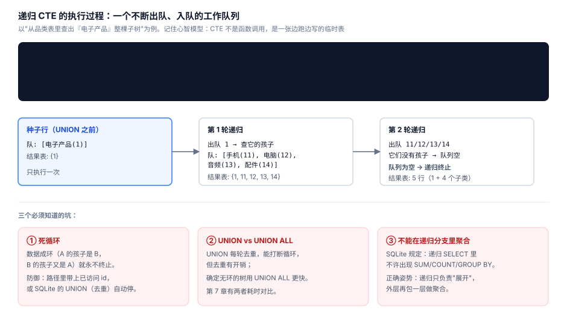

# 07 · 递归 CTE：SQL 里写循环

> 一句话：关系代数本来没有"迭代"，递归 CTE 把迭代塞了回来 —— 用于查树、查图、生成序列。心智模型不是"函数调用"，是**一张边跑边写的临时表**。



## 7.1 语法结构：两段式

```sql
WITH RECURSIVE sub(id) AS (
    -- ① 种子（Anchor）：只执行一次，给出起点
    SELECT category_id FROM categories WHERE name = '电子产品'
    UNION ALL
    -- ② 递归步（Recursive）：引用 CTE 自己，反复执行直到产出 0 行
    SELECT c.category_id
    FROM categories c JOIN sub s ON c.parent_id = s.id
)
SELECT * FROM sub;
```

执行过程（工作队列视角）：

```
种子:   队列 [电子产品(1)]                         结果 {1}
第1轮:  出队 1 → 查孩子 → 入队 4 个子类            结果 {1, 11, 12, 13, 14}
第2轮:  出队 11/12/13/14 → 无孩子 → 队列空         结果 5 行，终止
```

## 7.2 实战一：带层级的品类树

```sql
WITH RECURSIVE tree(category_id, name, depth, path) AS (
  SELECT category_id, name, 0, name
  FROM categories WHERE parent_id IS NULL
  UNION ALL
  SELECT c.category_id, c.name, t.depth + 1, t.path || ' / ' || c.name
  FROM categories c JOIN tree t ON c.parent_id = t.category_id
)
SELECT depth AS 层级, name, path AS 路径 FROM tree ORDER BY path LIMIT 9;
```

```
┌──────┬──────────┬─────────────────┐
│ 层级 │ name     │ 路径            │
├──────┼──────────┼─────────────────┤
│    0 │ 图书     │ 图书            │
│    1 │ 技术书   │ 图书 / 技术书   │
│    1 │ 文学书   │ 图书 / 文学书   │
│    0 │ 家居生活 │ 家居生活        │
│    1 │ 厨具     │ 家居生活 / 厨具 │
│    1 │ 家具     │ 家居生活 / 家具 │
│    1 │ 收纳     │ 家居生活 / 收纳 │
│    0 │ 服饰鞋包 │ 服饰鞋包        │
│    1 │ 女装     │ 服饰鞋包 / 女装 │
└──────┴──────────┴─────────────────┘
```

技巧：**递归分支里多带一个 `path` 列**，排序时路径天然按树的先序排列 —— 一列顶掉一层循环逻辑。

## 7.3 实战二：员工汇报链

```sql
WITH RECURSIVE chain(employee_id, name, title, depth, path) AS (
  SELECT employee_id, name, title, 0, name
  FROM employees WHERE manager_id IS NULL          -- CEO 是根
  UNION ALL
  SELECT e.employee_id, e.name, e.title, c.depth + 1, c.path || ' → ' || e.name
  FROM employees e JOIN chain c ON e.manager_id = c.employee_id
)
SELECT depth AS 层级, title AS 职位, path AS 汇报链
FROM chain WHERE depth <= 2 ORDER BY depth, path LIMIT 6;
```

```
┌──────┬─────────────┬──────────────────────┐
│ 层级 │ 职位        │ 汇报链               │
├──────┼─────────────┼──────────────────────┤
│    0 │ CEO         │ 刘军                 │
│    1 │ 市场部 VP   │ 刘军 → 何梓涵        │
│    1 │ 客服部 VP   │ 刘军 → 何艳          │
│    1 │ 技术部 VP   │ 刘军 → 朱雨欣        │
│    1 │ 销售部 VP   │ 刘军 → 黄磊          │
│    2 │ 市场部 经理 │ 刘军 → 何梓涵 → 李娟 │
└──────┴─────────────┴──────────────────────┘
```

反向查询（"某员工的完整上级链"）只需把 JOIN 方向倒过来，从该员工出发往上爬。

## 7.4 实战三：生成序列 —— 递归不止查树

```sql
-- 日历表：把缺销售的日期补齐（6.4 提到的"补齐日历"）
WITH RECURSIVE dates(d) AS (
  SELECT date('2024-11-01')
  UNION ALL
  SELECT date(d, '+1 day') FROM dates WHERE d < date('2024-11-10')
)
SELECT d FROM dates;
-- 10 行连续日期，LEFT JOIN 销售表即可补零
```

```sql
-- 斐波那契：验证递归本身（两个状态列滚动前进）
WITH RECURSIVE fib(n, a, b) AS (
  SELECT 1, 0, 1
  UNION ALL
  SELECT n + 1, b, a + b FROM fib WHERE n < 12
)
SELECT n, a AS fib_n FROM fib;   -- 0,1,1,2,3,5,8,13,21,34,55,89
```

生成序列的三个常见用途：**日历补齐、测试数据、分桶区间**。生产库里专门的日历表（含节假日标记）更常见 —— 递归版适合临时分析。

## 7.5 三个坑及防御

**坑一：环 = 死循环**

数据成环（A→B→A）时 `UNION ALL` 版本永不终止。两种防御：

```sql
-- 防御①：UNION（去重版）—— 重复行不再入队，天然能停
-- 防御②：路径列 + 检查
WITH RECURSIVE walk(id, visited) AS (
  SELECT 1, ',' || 1 || ','
  UNION ALL
  SELECT c.target, w.visited || c.target || ','
  FROM edges c JOIN walk w ON c.source = w.id
  WHERE w.visited NOT LIKE '%,' || c.target || ',%'   -- 走过的不再走
)
SELECT * FROM walk;
```

实测提醒：atlas.db 的品类树无环，可以安全用 `UNION ALL`；**用户可编辑的图结构（关注关系、审批流）一律先考虑 UNION 或显式防环**。

**坑二：递归分支里不许聚合**

SQLite 明确禁止递归 SELECT 里出现 `SUM/COUNT/GROUP BY`（会破坏迭代语义）。正确姿势：递归只负责"展开"，外层再包一层聚合：

```sql
WITH RECURSIVE tree AS ( ... 展开整棵子树 ... )
SELECT category_id, SUM(...) FROM order_items JOIN tree USING (category_id)
GROUP BY category_id;    -- 聚合放在外面
```

**坑三：深度失控**

万一 WHERE 条件写漏，几百万行的表能被递归拖死。SQLite 提供 `cte_max_recursion_depth`（默认 1,000,000）；防御性写法是**递归分支永远带上 `WHERE depth < 32` 这类上限**，宁可结果不全，不要查询失控。

## 7.6 什么时候不用递归 CTE

| 场景 | 建议 |
|---|---|
| 树固定 ≤3 层（品类、组织架构） | 自连接即可，别过度设计 |
| 读多写少的深层树（评论区、分类） | 物化路径 / 嵌套集（第 10 章对比） |
| 图遍历需要最短路/权重 | 上图数据库或应用层算法，SQL 只取原始边 |

## 自测

1. 递归 CTE 的种子分支和递归分支各执行几次？
2. `UNION` 和 `UNION ALL` 在递归里除了去重，还有什么关键差异？
3. 写出"查员工 15 号的所有上级（从直属经理到 CEO）"的递归 CTE。
4. 为什么递归分支里不能写 `GROUP BY`？
