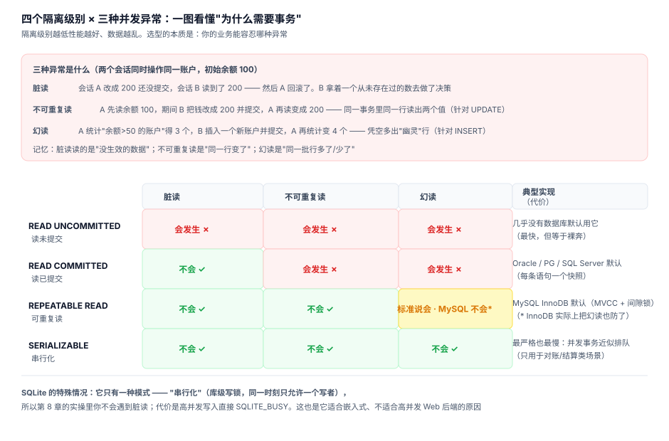

# 08 · 事务与并发：ACID 不是四个口号

> 一句话：ACID 每个字母都对应一个"没有它会出什么事"的故事。隔离级别则是一张"性能换正确性"的价目表。



## 8.1 用一个实验看懂原子性（A）

问题：转账 = "扣 A 加 B"两条 UPDATE，中间断了会怎样？

```python
import sqlite3
a = sqlite3.connect("atlas.db")
a.execute("BEGIN")
a.execute("UPDATE products SET stock = stock - 1 WHERE product_id = 3")
a.execute("INSERT INTO order_items (order_id, product_id, quantity, unit_price) VALUES (1, 1, -5, 10)")
# 第二条违反 CHECK(quantity > 0) → 抛异常
```

实测三个视角（完整代码见 `examples/01_transaction_lab.py`）：

| 观察点 | 结果 | 说明 |
|---|---|---|
| 事务内自己查库存 | **-1** | 你能看到自己未提交的修改 |
| 另一个连接查库存 | **0** | 别人看不到 —— 这就是隔离 |
| 显式 `ROLLBACK` 后 | **0** | 两条一起消失 —— 这就是原子 |
| 不提交直接关连接 | **0** | 隐式回滚 |

**关键教训：第二条语句报错后，事务并没有自动回滚！** 它还挂着，里面的半成品修改还在等你的指令。正确的异常处理：

```python
try:
    with conn:                     # 上下文管理器：成功 commit，异常自动 rollback
        cur.execute("UPDATE ...")
        cur.execute("INSERT ...")
except sqlite3.Error as e:
    ...                            # 出这里时已经回滚完毕
```

手写版等价于：

```python
try:
    ...两条语句...
    conn.commit()
except Exception:
    conn.rollback()      # 不写这句，连接就吊着一个挂起事务
    raise
```

## 8.2 一致性（C）：约束是守门员，事务是裁判

原子性保证"全做或全不做"，一致性保证"做了之后数据仍然合法"。两者分工：

- **约束**（第 2 章）：静态规则 —— 余额不能为负、外键必须存在
- **事务**：动态过程 —— 中间状态可以暂时非法，只要提交时合法

推论：**"检查-再更新"必须包在事务里，否则检查和更新之间数据可能被别人改掉**。这就是下面隔离级别的主题。

## 8.3 隔离性（I）：三种异常与四个级别


三种异常一句话版本（完整推演见图）：

- **脏读**：读到别人没提交的数据（可能被回滚 = 读到了"从未存在"的事实）
- **不可重复读**：同一事务里两次读同一**行**，值变了（别人 UPDATE 了）
- **幻读**：同一事务里两次执行同一**范围查询**，行数变了（别人 INSERT 了）

**SQLite 是个特例**：它只有一种模式 —— 库级写锁，同一时刻只允许一个写者，天然串行化。好处是永远不会遇到这三种异常；代价是写并发直接排队。实测（两个连接同时写）：

```python
# 连接 A: BEGIN IMMEDIATE; UPDATE ...
# 连接 B: BEGIN IMMEDIATE;            ← 同一时刻
# → sqlite3.OperationalError: database is locked
```

这正是 SQLite 适合"单机嵌入式"（App、浏览器、桌面软件）而不适合"高并发 Web 后端"的根本原因。服务端要并发，就用 PG/MySQL 的 MVCC：**读不加锁、写不阻塞读**，靠版本快照实现隔离。

## 8.4 持久性（D）：COMMIT 之后数据在哪

COMMIT 返回成功 ≠ 数据写进磁盘。真实流程：

```
1. 修改先写 WAL / redo log（顺序写，快）
2. COMMIT 返回
3. 后台异步把页刷进主数据文件（checkpoint）
```

宕机恢复 = 重放 WAL。这里藏着一个重要的可调参数 —— `synchronous`：

| 值 | 语义 | 实测速度（相对） | 断电风险 |
|---|---|---|---|
| `FULL` | 每次 commit 都 fsync | 1×（最慢） | 无丢失 |
| `NORMAL` | WAL 模式下只在 checkpoint 时 fsync | 5~50× | 断电可能丢最后几个事务，**但库不会损坏** |
| `OFF` | 完全不等 | 最快 | 断电可能损坏 |

手机上的微信选 FULL（丢消息是事故），埋点日志选 NORMAL 甚至 OFF（丢几条无所谓）。**持久性是可以按业务明码标价的**。

## 8.5 死锁：两个事务互相等

SQLite 的库级锁让它几乎不会死锁（只有一个写者），但 PG/MySQL 上这是必备知识：

```
事务 A：锁了行 1，想要行 2
事务 B：锁了行 2，想要行 1
→ 循环等待，数据库检测到后牺牲一个（报 deadlock 错误）
```

防御三件套：

1. **固定加锁顺序**：所有代码都先锁账户 ID 小的，再锁大的
2. **事务宁短勿长**：事务里不做 RPC、不问用户、不算大数
3. **收到死锁错误就重试**：死锁被杀不是 bug，是数据库在救你

## 8.6 实务守则汇总

```sql
-- ① 写操作显式开事务，别依赖自动提交（autocommit 逐条提交，批量写入慢 100 倍）
BEGIN;  ...;  COMMIT;

-- ② 批量导入前关掉不必要的检查，事后开回来
PRAGMA foreign_keys = OFF;  ...导入...  PRAGMA foreign_keys = ON;

-- ③ WAL 模式：读写并发的标配（SQLite）
PRAGMA journal_mode = WAL;

-- ④ 锁等待要有上限，别让用户界面卡死
PRAGMA busy_timeout = 3000;   -- 3 秒，而不是无限等
```

## 自测

1. 事务里第二条语句报 CHECK 错误后，第一条的修改处于什么状态？必须做什么才能撤销？
2. 为什么"先 SELECT 检查余额再 UPDATE"在并发下不可靠？正确做法是什么？
3. SQLite 为什么没有脏读？它为此付出了什么代价？
4. `synchronous=FULL` 和 `NORMAL` 各适合什么业务？说出你的判断依据。
