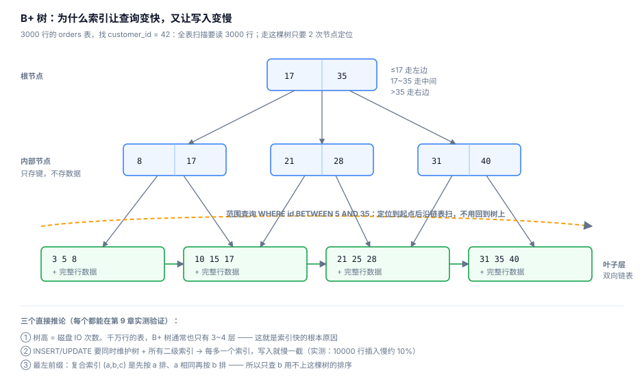
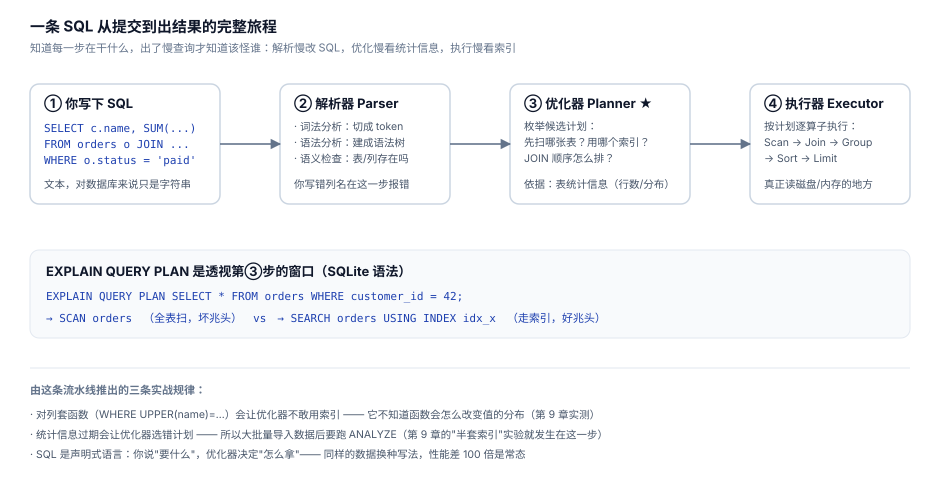

# 09 · 索引与执行计划：为什么加了个索引反而慢 10 倍

> 一句话：索引是拿写入速度和磁盘空间换读取速度的数据结构。它不是越多越好，也不是加了就一定用 —— 一切以 EXPLAIN 的输出为准。





## 9.1 先学会看执行计划

`EXPLAIN QUERY PLAN` 是你唯一的真相来源：

```sql
EXPLAIN QUERY PLAN SELECT * FROM orders WHERE customer_id = 42;
```

```
┌────┬────────┬─────────┬─────────────┐
│ id │ parent │ notused │ detail      │
├────┼────────┼─────────┼─────────────┤
│  2 │      0 │     216 │ SCAN orders │   ← 全表扫描 3000 行
└────┴────────┴─────────┴─────────────┘
```

关键词速查：

| 计划里出现 | 含义 | 好坏 |
|---|---|---|
| `SCAN 表` | 全表扫描 | 数据小时无所谓，大表要警惕 |
| `SEARCH ... USING INDEX` | 走索引定位 | 好 |
| `USING COVERING INDEX` | 覆盖索引，不回表 | 最好 |
| `USE TEMP B-TREE FOR GROUP BY/ORDER BY` | 要临时排序 | 结果大时是性能杀手 |
| `LEFT-FIXED-SCAN` / 嵌套 LOOP | 逐行匹配 | 看循环次数 |

## 9.2 一个完整的实测：从无索引到"正确的两个索引"

atlas.db 故意没建二级索引。以下实验代码在 `src/probe.py`，可以自己跑。

**初始状态：**

```
单表 WHERE customer_id=42     0.184 ms   SCAN orders
JOIN 聚合 customer_id=42      0.506 ms   SCAN i | SEARCH o USING INTEGER PRIMARY KEY
```

**① 只给 orders(customer_id) 建索引：**

```
单表 WHERE     0.057 ms   （3.2× 更快 ✓）
JOIN 聚合      5.522 ms   （0.09× —— 反而慢了 10 倍！！）
计划：SEARCH o USING INDEX idx_orders_customer | SCAN i
```

发生了什么？优化器看到新索引，改了主意：先用索引找到该客户的 10 个订单，然后**对每个订单去明细表里全表扫描**找匹配 —— 10 × 6048 行。旧计划"全扫明细 + 按主键查订单"反而只需 1 次全扫。

**这就是"半套索引比没索引更糟"**：外键关系两侧，只给一侧建了索引，优化器选中的新路径在另一侧塌方。

**② 补齐另一侧 order_items(order_id)：**

```
单表 WHERE     0.067 ms
JOIN 聚合      0.050 ms   （比初始快 10.1×，比①快 110.6×）
计划：SEARCH o USING INDEX ... | SEARCH i USING INDEX idx_items_order
```

三条结论：

1. **外键两侧都该有索引**（MySQL 会自动给外键建，SQLite/PG 需要——PG 会给外键自动建吗？不会，PG 只在主键侧自动建）—— 这一条是很多线上事故的根源
2. 索引让单点查询提速，但**JOIN 的速度取决于两边的索引**
3. "加了索引变慢"不是玄学，是优化器基于可用信息选了一条更差的路径 —— 用 EXPLAIN 一眼看穿

## 9.3 索引失效的四种姿势（全部实测）

```sql
CREATE INDEX idx_orders_customer ON orders(customer_id);
```

| 写法 | 计划 | 结论 |
|---|---|---|
| `WHERE customer_id = 42` | `SEARCH USING INDEX` | ✓ 正常 |
| `WHERE customer_id + 0 = 42` | `SCAN` | ✗ 列上做运算 |
| `WHERE CAST(customer_id AS TEXT) = '42'` | `SCAN` | ✗ 列上套函数 |
| `WHERE customer_id = '42'` | `SEARCH USING INDEX` | ✓ SQLite 宽松转换仍可用（PG 会报错或隐式转换） |
| `WHERE customer_id LIKE '42'` | `SCAN` | ✗ LIKE 对数字列无意义 |

守则：**别对索引列做任何运算/函数包裹，把运算挪到常量那一侧。** 真的需要函数匹配，用表达式索引（9.5）。

## 9.4 复合索引与最左前缀

```sql
CREATE INDEX idx_orders_cs ON orders(customer_id, status);
```

| 查询 | 能否用上 | 原因 |
|---|---|---|
| `WHERE customer_id = 42` | ✓ | 最左列匹配 |
| `WHERE customer_id = 42 AND status='paid'` | ✓✓ | 两列全用上 |
| `WHERE status = 'paid'` | ✗ SCAN | **跳过最左列 = 用不上** |
| `WHERE customer_id = 42 ORDER BY status` | ✓ | 索引序 = 排序序，免排序 |

为什么？复合索引的排序规则是"先按 customer_id 排，customer_id 相同的再按 status 排"。只给 status，在这棵树上等于问"所有名字叫小明的人按什么省排" —— 没法定位。

**设计复合索引的口诀：等值条件列在前，范围/排序列在后。**

```sql
-- 查询模式：WHERE customer_id = ? AND ordered_at > ?
CREATE INDEX idx_good ON orders(customer_id, ordered_at);   -- ✓ 等值在前
CREATE INDEX idx_bad  ON orders(ordered_at, customer_id);   -- ✗ 反了：范围列挡住后面的列
```

## 9.5 覆盖索引：终极优化

查询的列**全部**在索引里时，不需要回表取行 —— 从"读索引+读行"变成"只读索引"：

```sql
CREATE INDEX idx_orders_cover ON orders(customer_id, status, ordered_at);

EXPLAIN QUERY PLAN
SELECT customer_id, status, ordered_at FROM orders WHERE customer_id = 42;
-- → SEARCH orders USING COVERING INDEX idx_orders_cover (customer_id=?)
--                          ^^^^^^^^ COVERING = 免回表

EXPLAIN QUERY PLAN
SELECT customer_id, status, ordered_at, note FROM orders WHERE customer_id = 42;
--                    ↑ 多查一个不在索引里的列
-- → SEARCH orders USING INDEX idx_orders_cover (customer_id=?)   ← 退回普通索引，要回表
```

覆盖索引是只读热点查询的杀手锏（计数、状态汇总），代价是索引变大、写放大。**按查询模式设计，而不是按表设计。**

## 9.6 索引的代价：写放大实测

```python
# 插入 10000 行，测量 COMMIT 耗时
#   无二级索引:  78.1 ms
#   1 个二级索引: 86.0 ms   （+10%）
```

每加一个索引，写路径多维护一棵 B+ 树。经验值：**每多一个索引，批量写入慢 5%~15%**，索引越多越明显。 OLTP 高写入表（日志、埋点）要克制索引数量；分析库（少写多读）可以放开建。

## 9.7 索引设计的决策清单

```
1. 这个查询模式值得优化吗？（执行频率 × 单次收益）
2. WHERE / JOIN / ORDER BY 用到哪些列？
3. 等值列在前，范围列在后；把 SELECT 里的其他列也塞进去变成覆盖索引（若表不大）
4. 外键关系：两侧都检查有没有索引
5. 建完 ANALYZE 更新统计信息，EXPLAIN 确认生效
6. 上线后观察：写入变慢了多少？值不值？
```

## 自测

1. 复合索引 `(a, b, c)`，以下查询哪些用得上？`WHERE b=1` / `WHERE a=1 AND b>2` / `WHERE a=1 ORDER BY c`
2. 为什么"外键只在一侧建索引"会让 JOIN 慢 10 倍？用 SCAN/SEARCH 术语解释。
3. `WHERE DATE(created_at) = '2024-01-01'` 怎么改写才能用上索引？
4. 什么情况下应该删掉一个索引？
