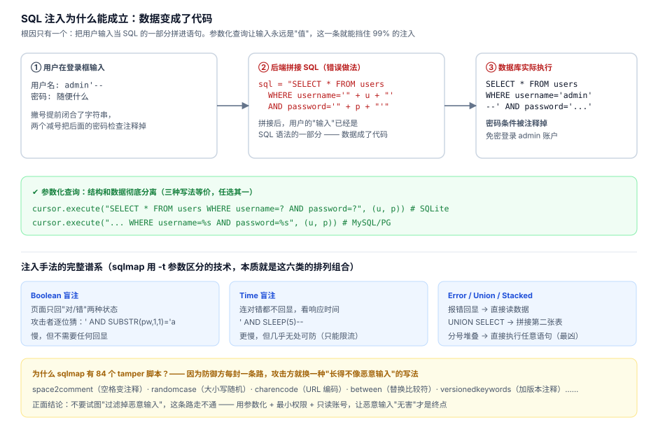

# 11 · SQL 注入与防御：从 sqlmap 的视角理解攻击

> 一句话：注入的根因只有一个 —— 用户输入被当成了 SQL 代码。理解攻击面的"完整谱系"，才能理解为什么"过滤特殊字符"这条路永远走不通。



## 11.1 三分钟复现一次注入

atlas.db 里有个反面教材 `users` 表（明文密码），配套的漏洞代码在 `examples/02_injection_demo.py`：

```python
# ❌ 漏洞版：字符串拼接
def login_vulnerable(username, password):
    sql = "SELECT * FROM users WHERE username='" + username + "' AND password='" + password + "'"
    return db.execute(sql).fetchone()

login_vulnerable("admin", "whatever")            # 正常登录，密码错误 → 返回空
login_vulnerable("admin'--", "whatever")         # 返回 admin 行！免密登录成功
login_vulnerable("' OR '1'='1", "x")             # 返回第一行任意用户
```

`admin'--` 拼接后数据库实际执行的是：

```sql
SELECT * FROM users WHERE username='admin'--' AND password='whatever'
                                ↑ 撇号闭合字符串      ↑ 两个减号把密码检查注释掉
```

**输入的角色从"数据"变成了"代码" —— 这就是全部原理。** 后面所有花样都是这句话的变体。

## 11.2 修复：参数化查询

```python
# ✔ 参数化版：SQL 结构与数据彻底分离
def login_safe(username, password):
    sql = "SELECT * FROM users WHERE username=? AND password=?"
    return db.execute(sql, (username, password)).fetchone()

login_safe("admin'--", "whatever")   # 返回空 —— 用户名就叫 "admin'--" 的用户不存在
```

参数化之下，`admin'--` 只是一个**字符串值**，数据库永远不会把它解释成语法。注意：

- 换框架也一样：SQLAlchemy 的 `text()` 绑定参数、Django ORM 的 filter、MyBatis 的 `#{}` 都是参数化
- **MyBatis 的 `${}` 是拼接，`#{}` 是参数化** —— 一字之差，注入之门（Java 面试高频）

实测对比完整代码跑一遍 `python examples/02_injection_demo.py`，能看到同一输入在两种写法下的真实行为差异。

## 11.3 攻击手法谱系：sqlmap 的分类学

[sqlmap](https://github.com/sqlmapproject/sqlmap)（38.7k★，至今活跃）把注入技术分六类（对应它的 `-t` 参数）：

| 类型 | 原理 | 适用场景 | 速度 |
|---|---|---|---|
| **Boolean 盲注** | 条件真/假 → 页面两种状态 | 无回显有差异 | 慢（二分猜字符） |
| **Time 盲注** | `AND SLEEP(5)--` → 响应延迟 | 连差异都没有 | 极慢 |
| **Error-based** | 故意报错回显数据 | 错误信息暴露 | 快 |
| **UNION** | `UNION SELECT` 拼接第二张表 | 能看到查询结果 | 快 |
| **Stacked** | 分号堆叠任意语句 | 驱动支持多语句 | 最凶险（能 DROP） |
| **Inline** | 内联查询嵌套 | 补充手段 | — |

**盲注最值得细品**：页面只回"登录成功/失败"两个状态，攻击者照样能逐位把密码表猜出来：

```sql
' AND (SELECT unicode(substr(password,1,1)) FROM users WHERE username='admin') > 109--
```

二分 7 次 = 猜出 1 个字符。没有回显 ≠ 安全，只是攻击更慢。**防御必须假设攻击者知道你的全部表结构**（表结构迟早泄露：开源代码、错误信息、文档、前员工）。

## 11.4 84 个 tamper 脚本：为什么"过滤"永远赢不了

sqlmap 的 `tamper/` 目录有 84 个脚本，每个是一种"变形手法"，让 payload 看起来不像恶意输入。按意图分类：

| 手法族 | 代表脚本 | 在干什么 |
|---|---|---|
| 空格变形 | `space2comment` `space2dash` `space2hash` `space2plus` | `UNION SELECT` → `UNION/**/SELECT` |
| 大小写/注释混淆 | `randomcase` `randomcomments` | `SeLeCt/**/CoLuMn` |
| 编码 | `charencode` `base64encode` `overlongutf8` `percentage` | URL 编码、超长 UTF-8、%编码 |
| 等价替换 | `equaltolike` `greatest` `ifnull2casewhenisnull` | `=` → `LIKE`、`IFNULL` → `CASE WHEN` |
| 关键字注释 | `versionedkeywords` `halfversionedmorekeywords` | `UNION` → `/*!UNION*/`（MySQL 方言） |
| 联合变形 | `unionalltounion` `commalesslimit` | 绕 `LIMIT 0,1` 的逗号过滤 → `LIMIT 0.1` |

反面教材的结论：

> **基于黑名单/正则的过滤注定失败** —— 因为 SQL 语法可以无限变形，而你的正则表有限。
> "过滤恶意输入"是场打不赢的仗。正确的目标不是"识别恶意"，是**"让恶意无害"**。

## 11.5 纵深防御清单

参数化只是第一层。完整防御按层排列：

```
① 参数化查询（消灭注入本身）
   └ 所有 SQL 一律绑定参数；审查框架里所有原生 SQL 拼 String 的地方

② 最小权限（就算被注入，损失封顶）
   └ 应用连数据库的账号：只给业务库的 SELECT/INSERT/UPDATE
   └ 绝不用 root/sa；报表账号只读；删除类操作走独立审核通道

③ 错误信息不外泄（断掉 Error-based 的回显）
   └ 生产环境关掉详细错误页；日志里的 SQL 异常不进用户视线

④ 输入校验（锦上添花，别当主力）
   └ 类型/长度/格式校验用白名单（"手机号必须是 11 位数字"）
   └ 黑名单过滤特殊字符 → 无效（见 11.4）

⑤ 关键操作二次确认 / 审计
   └ audit_log（02 章的触发器）就是审计的最小实现
```

**合法渗透测试的边界**：sqlmap 只能对**你拥有或获得书面授权**的系统使用。拿它扫别人 = 违法（中国《刑法》285/286 条，非法侵入计算机信息系统罪/破坏计算机信息系统罪）。本章的所有实验都在本仓库自己的 SQLite 库里完成 —— 这就是正确的学习姿势。

## 11.6 延伸：注入之外还有三类输入型攻击

| 攻击 | 和 SQL 注入的共同点 | 一句话防御 |
|---|---|---|
| XSS | 输入被当代码执行（JS） | 输出转义 + CSP |
| 命令注入 | 输入拼进 shell 命令 | 参数数组形式调用，不用 shell=True |
| 路径穿越 | `../../` 改变路径语义 | 白名单目录 + 规范化后校验 |

同一句话贯穿：**数据与代码的边界必须在运行时保持清晰。**

## 自测

1. 为什么 `admin'--` 能免密登录？写出拼接后的完整 SQL 并标出变化点。
2. 参数化查询为什么从原理上免疫注入？（对比"过滤特殊字符"为什么只是治标）
3. Boolean 盲注在"页面只有成功/失败两种状态"时怎么工作？写出猜第一位密码的 SQL。
4. 你的应用账号应该有哪些权限？为什么"最小权限"能封顶注入损失？
5. MyBatis 的 `#{}` 和 `${}` 有什么区别？
