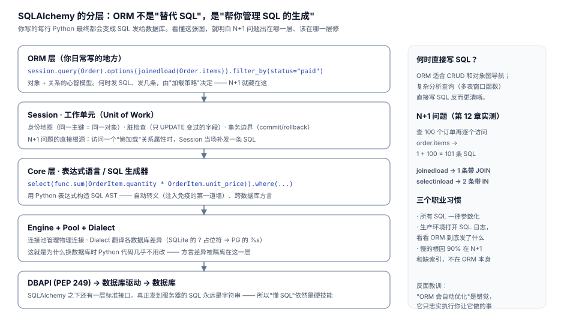

# 12 · SQLAlchemy：ORM 的价值与陷阱

> 一句话：ORM 不是"让你不用学 SQL"，是"帮你管理 SQL 的生成、转义与事务边界"。它最有名的坑（N+1）恰恰是没懂 SQL 的人踩的。



## 12.1 60 秒上手（2.0 风格）

```python
from sqlalchemy import create_engine, ForeignKey, String
from sqlalchemy.orm import DeclarativeBase, Mapped, mapped_column, relationship, sessionmaker

class Base(DeclarativeBase): pass

class Customer(Base):
    __tablename__ = "customers"
    customer_id: Mapped[int] = mapped_column(primary_key=True)
    name: Mapped[str] = mapped_column(String(50))
    orders: Mapped[list["Order"]] = relationship(back_populates="customer")

class Order(Base):
    __tablename__ = "orders"
    order_id: Mapped[int] = mapped_column(primary_key=True)
    customer_id: Mapped[int] = mapped_column(ForeignKey("customers.customer_id"))
    status: Mapped[str] = mapped_column(String(20))
    customer: Mapped["Customer"] = relationship(back_populates="orders")

engine = create_engine("sqlite:///data/atlas.db")
Session = sessionmaker(engine)
```

注意：模型类**可以直接映射到 atlas.db 的现有表**，不需要 ORM 建表 —— ORM 和裸 SQL 操作同一个库，两边的视角可以互相验证。

## 12.2 CRUD 与查询

```python
with Session() as s:
    # 查
    gold = s.query(Customer).filter_by(tier="gold").all()

    # 等价的 2.0 select 风格
    from sqlalchemy import select
    stmt = select(Customer).where(Customer.tier == "gold").order_by(Customer.customer_id)
    gold = s.execute(stmt).scalars().all()

    # 增
    s.add(Order(order_no="SO-TEST-1", customer_id=1, status="pending", ordered_at="2024-12-31 00:00:00"))
    s.commit()                       # Session 是工作单元：add 后要 commit 才落库

    # 改：对象属性直接赋值，commit 时自动 UPDATE
    o.status = "paid"                # ← 脏检查：只 UPDATE 变过的字段
    s.commit()

    # 删
    s.delete(o); s.commit()
```

## 12.3 N+1 问题：实测 31 条 SQL 变 2 条

写法完全一样，性能差 10 倍以上 —— 取决于访问关系属性的方式：

```python
def n_plus_one(s):
    """看起来人畜无害的循环"""
    total = 0
    for c in s.query(Customer).limit(30):
        total += len(c.orders)      # ← 每次访问 c.orders，Session 当场补发一条 SQL
    return total
```

实测（30 个客户）：

| 写法 | 发出的 SQL | 耗时 | 发生了什么 |
|---|---|---|---|
| 默认懒加载 | **31** 条 | 24.2 ms | 1 条查客户 + 30 条逐个查订单 |
| `joinedload` | 1 条 | 10.4 ms | 大 JOIN（行会膨胀，网络传输多） |
| `selectinload` | **2** 条 | **4.3 ms** | 1 条客户 + 1 条 `WHERE id IN (...)` |

```python
from sqlalchemy.orm import joinedload, selectinload

s.query(Customer).options(joinedload(Customer.orders)).limit(30)    # 1 条 SQL
s.query(Customer).options(selectinload(Customer.orders)).limit(30)  # 2 条 SQL
```

两个策略怎么选：

- **`selectinload`（多对一/一对多默认首选）**：2 条简单查询，无行膨胀，本次实测最快
- **`joinedload`**：适合多对一（每个订单 JOIN 它的客户，一对一不膨胀）
- **`raiseload`**：显式禁止懒加载，让 N+1 在测试阶段直接报错 —— 大型项目的防呆利器

```python
orders: Mapped[list["Order"]] = relationship(
    back_populates="customer",
    lazy="raise_on_sql",     # 没预加载就访问 → 直接抛异常，N+1 无处藏身
)
```

## 12.4 Session 的三个心智规则

1. **身份地图**：同一事务里，主键相同的行只会有一个 Python 对象。`s.get(Customer, 1) is s.get(Customer, 1)` → True。改了对象不 commit，是**不会**落库的。
2. **事务边界 = Session 生命周期**：短事务模式（Web 请求一个 Session）是标准姿势；长命 Session 会积累脏检查负担还容易撞锁。
3. **expire_on_commit**：commit 之后对象属性标记过期，下次访问会重新 SELECT（在 Web 框架里表现为"commit 后访问属性报 DetachedError"）。了解它，少走一小时弯路。

## 12.5 复杂查询：直接写 SQL 一点不丢人

窗口函数、递归 CTE、PIVOT 这类查询用 ORM 表达会非常绕。SQLAlchemy 给了干净的逃生门：

```python
from sqlalchemy import text

# text() 里的 :param 是绑定参数（自动转义，第 11 章的参数化）
stmt = text("""
    WITH s AS (
        SELECT c.customer_id, c.name, c.city,
               SUM(i.quantity*i.unit_price*(1-i.discount)) AS amt
        FROM customers c
        JOIN orders o ON o.customer_id = c.customer_id
        JOIN order_items i ON i.order_id = o.order_id
        WHERE o.status IN ('paid','shipped')
        GROUP BY c.customer_id
    ), ranked AS (
        SELECT *, ROW_NUMBER() OVER (PARTITION BY city ORDER BY amt DESC) rn
        FROM s
    )
    SELECT city, name, ROUND(amt,0) AS amt FROM ranked WHERE rn <= 2
""")
rows = s.execute(stmt, {"min_amt": 0}).all()
```

职业判断：**CRUD 和对象图导航用 ORM；分析型查询直接 SQL。** 混用完全正常 —— SQLAlchemy 的 Core 层本来就是为两者共存设计的。

## 12.6 ORM 的真实价值（面试怎么答）

| ORM 给的 | 不用 ORM 的代价 |
|---|---|
| 参数化转义默认开启 | 每条 SQL 手动防注入（人会疏忽） |
| 方言隔离（换库改配置） | `?` vs `%s` vs `$1` 手写适配 |
| 工作单元/脏检查 | 手写"只更新变更字段"的 diff 逻辑 |
| 模型即文档 | 表结构散落在迁移脚本里 |
| 连接池 | 自己管理连接生命周期 |

它的代价也要心里有数：复杂查询表达力差（→ 混用 text）、隐式行为多（N+1、expire）、性能上限低于手调 SQL。**结论：ORM 是工具不是信仰，关键路径的 SQL 必须亲自看过。**

## 12.7 调试 ORM 的三个开关

```python
# ① 看 SQL（开发环境必开）
import logging
logging.basicConfig()
logging.getLogger("sqlalchemy.engine").setLevel(logging.INFO)

# ② 统计 SQL 条数（回归测试里防 N+1 复发）
from sqlalchemy import event
count = 0
@event.listens_for(engine, "before_cursor_execute")
def _(conn, cursor, stmt, params, *a):
    global count; count += 1

# ③ EXPLAIN 照样能跑（拿到的是 SQL 层的真相）
for row in s.execute(text("EXPLAIN QUERY PLAN " + str(stmt.compile(engine))).text.split(";")):
    ...
```

## 自测

1. 30 个客户循环取订单为什么发出 31 条 SQL？`selectinload` 怎么把它变成 2 条？
2. `joinedload` 和 `selectinload` 各自的适用场景？为什么本例 selectin 更快？
3. "同一事务里主键相同的行只有一个对象"带来什么好处和什么坑？
4. 为什么说"ORM 让人不用学 SQL"是伪命题？
